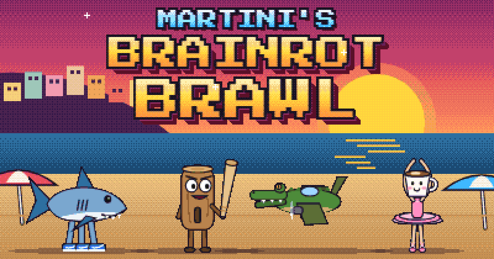

# Martini's Brainrot Brawl

An open-source 1v1 pixel-art fighting game for the browser, starring the Italian brainrot memes. It has no install, no build step and no dependencies.

[](https://martinipolice.github.io/brainrot-brawl/)
[](https://github.com/martinipolice/brainrot-brawl/deployments)

[](LICENSE)



**[▶ Play it in your browser](https://martinipolice.github.io/brainrot-brawl/)**. It works on desktop, and on phones and tablets with on-screen controls.

## Features
- **Three modes:**
  - **Arcade:** beat the other three fighters, then a shadow copy of yourself, and see the ending.
  - **Versus CPU:** Easy, Normal or Hard.
  - **2 Players:** on one keyboard.
- **Four fighters:**
  - Tralalero Tralala
  - Tung Tung Tung Sahur
  - Bombardiro Crocodilo
  - Ballerina Cappuccina

  Each has their own special and a cinematic ultimate.
- **Fighting system:**
  - light, heavy and special attacks;
  - guarding by holding back, dashes, rush attacks and launchers;
  - L, L, H chains and special cancels;
  - an SP gauge, a SUPER meter and rage mode.
- **Six stages:** each reacts to the fight with swinging lanterns, cheering crowds, a bomber flyover, a falling chandelier, smashing crates and lightning.
- **Arcade feel:**
  - hitstop, screen shake, particles and tumbling KO physics;
  - a 320×180 palette-locked pixel look and an optional CRT filter.
- **Sound:**
  - all sound is synthesized live with the Web Audio API, with no audio files;
  - the music builds as the fight heats up;
  - an announcer in Japanese-accented or plain English.

## Controls
| | Player 1 | Player 2 |
|---|---|---|
| Move · jump | A D · W | ← → · ↑ |
| Guard | hold S or back | hold ↓ or back |
| Light · heavy · special | J K L | , . / (Numpad 1 2 3) |
| Ultimate (full SUPER) | K + L | . + / |

| Input (facing right) | Move |
|---|---|
| → → / ← ← | Dash / backstep |
| → + Heavy | Rush attack |
| ← + Heavy | Launcher |
| Light, Light, Heavy | Chain combo |

Other keys:
- Esc pauses, M mutes and C toggles the CRT filter.
- Light, Heavy or Special skips the ROUND call, ultimate cut-ins and the end-of-round tally.
- In menus, the arrows or WASD move and Enter or J selects.
- On phones and tablets, an on-screen pad controls Player 1: slide your thumb on the d-pad (diagonals work), tap L, H, S or ULT, and ❚❚ pauses. Play in landscape for the biggest view.

## Run it locally
The game is plain HTML, CSS and JavaScript modules. Browsers only load modules over HTTP, so serve the folder rather than opening `index.html` directly.

```bash
git clone https://github.com/martinipolice/brainrot-brawl.git
```

```bash
cd brainrot-brawl
```

```bash
python -m http.server 8000
```

Then open http://localhost:8000. Any static server works. Settings and the hi-score are saved in the browser's `localStorage`.

## Project structure
`index.html` loads `js/main.js` as an ES module, and that module imports everything else.

| Path | Contents |
|---|---|
| `js/main.js` | Entry point and the fixed 60 Hz game loop |
| `js/core/` | Constants, saved settings, shared state, helpers |
| `js/game/` | Fighters, roster, match flow, combat, effects |
| `js/stages/` | One file per stage: backdrop, ambient motion, reactions |
| `js/render/` | Canvas, shape helpers, pixel pass, camera, HUD |
| `js/audio/` | Mixer, sound effects, music, announcer |
| `js/input/` | Key maps, hotkeys, touch pad |
| `js/ai/cpu.js` | CPU opponent |
| `js/ui/` | Title, select, VS, ending, menus, screen flow |
| `js/tests/selftest.js` | Self-check |
| `css/` | Styles, one file per part of the page |

Shared state lives in the module that owns it, and other modules change it through setters such as `setGame()`. All art is drawn in code with canvas shapes; there are no sprite sheets.

## Contributing
Bug reports, ideas and pull requests are welcome. [Open an issue](https://github.com/martinipolice/brainrot-brawl/issues) to report a bug or suggest something.

For a pull request:
1. Keep it dependency-free and build-free.
2. Before you submit, run the self-check by opening `http://localhost:8000/#selftest` or calling `selfTest()` in the browser console. All 20 checks should pass.
3. If the change is visible to players, add a line to [CHANGELOG.md](CHANGELOG.md).

## AI disclosure
This game was built with Claude, Anthropic's AI, as a coding assistant. I directed the project. The game design, features, characters, stages, look and feel, and the approval of every change are mine. Most of the code was written by Claude under that direction, and I checked it in play.

## License
The code is under the [MIT License](LICENSE).

This is a fan-made parody. The characters are internet memes, redrawn here from scratch with canvas shapes, and are not owned by this project.
